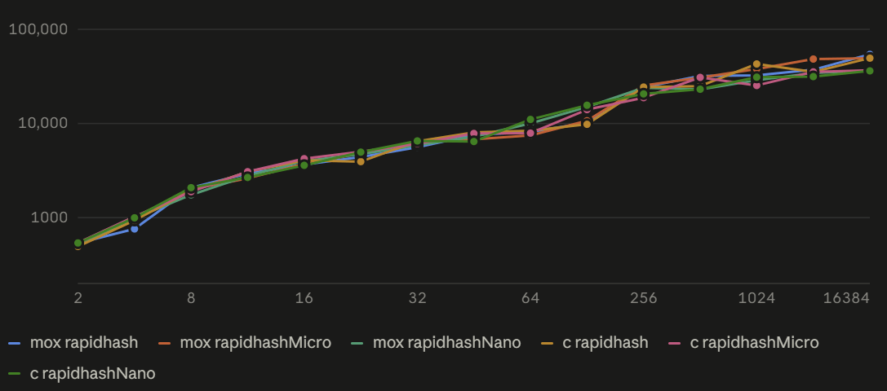

Windows 11 x86_64  
Intel Ultra 9 185H, laptop

## Compilation speed of simple 200k funcs

|                  | emit exe  | vs mox | emit obj  | vs mox |
|------------------|-----------|--------|-----------|--------|
| mox 0.3.1 jit    | 0.5 sec   |   1.0x | 0.4 sec   |   1.0x |
| mox 0.3.1 llvm   | 2.5 sec   |   5.0x | 2.4 sec   |   6.0x |
| rustc 1.100.0    | 33 sec    |  66.0x | 33.1 sec  |  82.8x |
| clang 19.1.3     | 13.3 sec  |  26.6x | 13.1 sec  |  32.8x |
| odin dev-2026-11 | 7.69 sec  |  15.4x | 7.3 sec   |  18.3x |

```bash
node ./generate.js

# emit exe

time mox ./200k.mox backend=jit
time mox ./200k.mox backend=llvm
time clang ./200k.c -O0
time RUST_MIN_STACK=2147483648 rustc -C debuginfo=0 -C opt-level=0 ./200k.rs
time odin build ./200k.odin -file -o:none

# emit obj

time mox ./200k.mox linker=false backend=jit
time mox ./200k.mox linker=false backend=llvm
time clang -c ./200k.c -O0
time RUST_MIN_STACK=2147483648 rustc -C debuginfo=0 -C opt-level=0 ./200k.rs --emit=obj
time odin build ./200k.odin -file -opt:0 -build-mode:obj
```

## Compilation speed of 25k generics over 8 types

|                  | emit exe  | vs mox |
|------------------|-----------|--------|
| mox 0.3.1 jit    | 1.25 sec  |   1.0x |
| mox 0.3.1 llvm   | 7.7 sec   |   6.2x |
| rustc 1.100.0    | 38.3 sec  |  30.6x |
| clang++ 19.1.3   | 36.2 sec  |  29.0x |
| odin dev-2026-11 | 9.4 sec   |   7.5x |

```bash
node ./generate_generics.js
bash ./run_generics.sh
```

## Rapidhash

MB/s, higher is better



## Hash Maps

ns/op, less is better

mox HashMap vs robin_hood::unordered_flat_map  
mox SwissMap vs phmap::flat_hash_map


